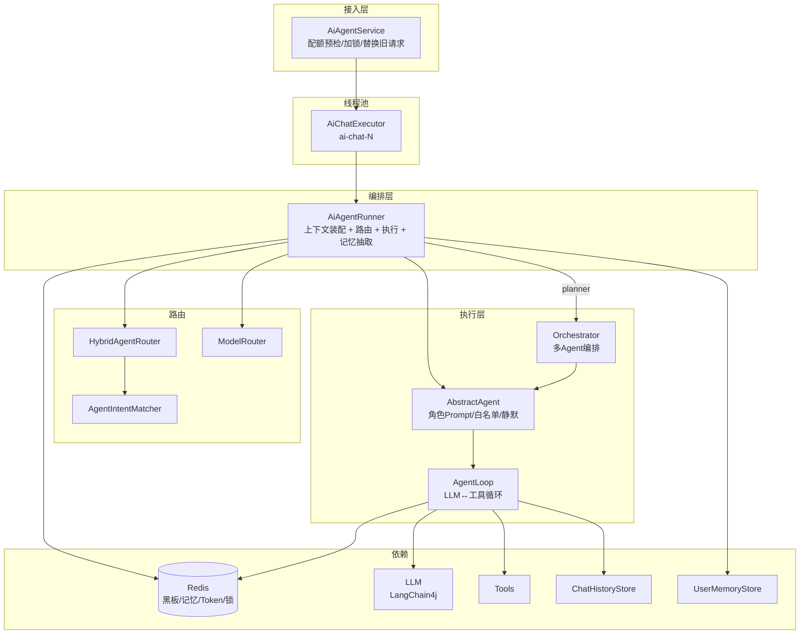
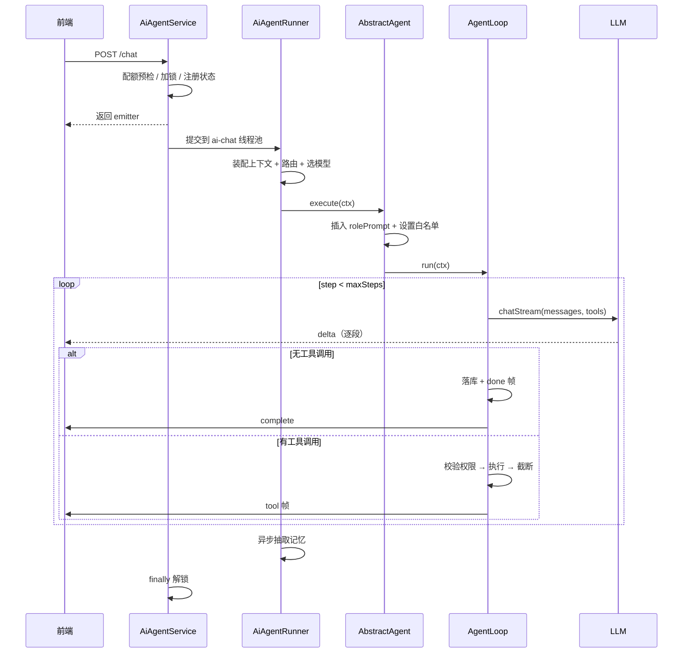
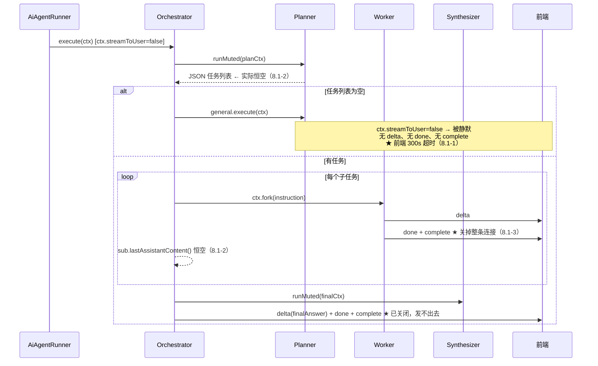

# iam-backend-ai 智能体模块开发文档

> 适用范围：`com.lenovo.ai.*`（iam-backend-ai 项目 AI 模块）
> 文档版本：v1.0
> 基于代码快照：当前提交（含 agent / memory / token / tools / llm / config 六个包）
> 读者：后端开发、架构评审、测试

---

## 目录

1. [文档说明](#1-文档说明)
2. [系统总览](#2-系统总览)
3. [整体架构与调用链路](#3-整体架构与调用链路)
4. [模块详解](#4-模块详解)
5. [数据模型与存储设计](#5-数据模型与存储设计)
6. [配置参考](#6-配置参考)
7. [关键流程时序](#7-关键流程时序)
8. [已知问题清单](#8-已知问题清单)
9. [可行性优化建议](#9-可行性优化建议)
10. [附录：扩展指南](#10-附录扩展指南)

---

## 1. 文档说明

本文覆盖三件事：

1. **开发文档**：模块职责、包结构、核心链路、数据模型、Redis Key 设计、配置项，以及新增 Agent / 工具 / 存储的操作方式。
2. **缺陷清单**：对全量源码逐类审查后定位的问题，按 P0（功能不可用）/ P1（功能受损或上线阻塞）/ P2（工程质量）分级，每条给出位置、现象、根因与修复方案。
3. **优化建议**：按"止血 → 链路正确性 → 性能成本 → 工程化"四个阶段给出的可行性方案，附收益 / 成本 / 风险评估。

> ⚠️ **重要前置结论**：当前代码状态下，**多 Agent 编排链路（Planner → 子任务 → Synthesizer）处于"通了电但不工作"的状态**。被判定为复杂的问题（极易命中，见 8.2-15）会落入一条静默降级路径，最终表现为**前端转圈 300 秒后超时、无任何输出**。建议优先执行第 9.1 节的止血方案。

---

## 2. 系统总览

### 2.1 模块定位

企业智能助手后端。在一次对话请求内完成：身份/记忆上下文装配 → Agent 路由 → 单 Agent 或多 Agent 编排 → 工具调用 → 流式输出 → 落库 → 记忆抽取 → Token 计量。

核心能力：

| 能力 | 实现要点 |
|---|---|
| 多 Agent 路由 | 显式指定 > 复杂度判定 > 关键词意图 > LLM 挑选 > 兜底，五级降级 |
| 多 Agent 编排 | Planner 规划 → 黑板分发 → Worker 执行 → Synthesizer 汇总 |
| 工具调用 | 角色白名单 + Agent 白名单双重校验，支持人工确认、超时、截断 |
| 长期记忆 | 向量召回 + 精确去重 + 语义去重 + 每日衰减 + 低分清理 |
| 上下文工程 | 身份卡片 / 提及用户卡片 / 长期记忆 / 历史摘要 分块注入 + Token 预算裁剪 |
| 成本控制 | 用量/成本双轨计量，日/月配额，缓存 token 折扣计价 |
| 流式输出 | SSE，支持内部 Agent 静默（mute + suppressComplete） |

### 2.2 技术栈

| 层 | 选型 |
|---|---|
| 框架 | Spring Boot 3.x（ Jakarta EE ）、Spring MVC SseEmitter |
| LLM | LangChain4j 1.x（OpenAiChatModel / OpenAiStreamingChatModel / OpenAiEmbeddingModel） |
| 向量存储 | Redis Stack RediSearch（HNSW / COSINE / FLOAT32），Lettuce 原生连接直发 `FT.*` |
| 缓存与锁 | Spring Data Redis（StringRedisTemplate）+ Lua 解锁 |
| JSON | Jackson（JacksonConfig 统一 ObjectMapper），部分模块用 fastjson2 |
| 监控 | Micrometer（TokenMetrics） |
| 构建 | Lombok、jtokkit（可选精确 token 估算） |

### 2.3 包结构总览

```
com.lenovo.ai
├── agent                      # 编排入口与多 Agent 调度
│   ├── AiAgentRunner          # 主链路编排（上下文装配→路由→执行→记忆抽取）
│   ├── Orchestrator           # Planner→Worker→Synthesizer 多 Agent 编排
│   ├── ChatRequest            # 请求 DTO
│   ├── blackboard             # 黑板（一次 run 一块，Redis 实现）
│   │   ├── Blackboard / RedisBlackboard / BlackboardFactory
│   │   └── AgentTask / AgentResult
│   ├── core                   # Agent 抽象与注册
│   │   ├── Agent / AbstractAgent / AgentRegistry
│   │   └── impl               # Planner / Synthesizer / Knowledge / Ticket / General
│   ├── loop                   # 执行循环
│   │   ├── AgentLoop          # LLM↔工具循环（配额、工具、SSE、落库）
│   │   ├── AgentContext       # 执行上下文（消息、工具白名单、模型、黑板）
│   │   └── PendingStateStore  # 工具确认挂起状态
│   ├── router                 # 路由
│   │   ├── HybridAgentRouter / AgentIntentMatcher
│   │   ├── ModelRouter / KnowledgeRouter
│   │   └── RoutingRequest
│   └── runtime/AiChatExecutor # AI 专用线程池
├── service                    # 接入层
│   ├── AiAgentService         # SSE 入口：配额、加锁、旧请求替换、线程池提交
│   ├── ChatService            # 另一条简易链路（经 MemoryFacade，当前未被主入口使用）
│   └── RequestState
├── memory                     # 长期记忆
│   ├── context                # ContextBuilder / SummaryService
│   ├── extractor              # MemoryExtractor / MemoryParser / MemoryExtractionPrompt
│   ├── store                  # UserMemoryStore（业务门面）/ MemoryStore / MemoryMaintenanceStore
│   │   └── redis              # RedisMemoryStore（Hash + RediSearch）/ MemoryKeys
│   ├── embedding              # EmbeddingClient / LangChain4jEmbeddingClient
│   ├── facade/MemoryFacade    # 记忆模块统一门面
│   ├── model                  # MemoryItem / MemoryHit / MemoryType
│   ├── job/MemoryDecayJob     # 每日衰减任务
│   └── util                   # TextUtils / VectorUtils / RedisBytes
├── token                      # Token 计量与配额
│   ├── context/ContextTrimmer # 上下文裁剪
│   ├── counter                # TokenCounter / RedisTokenCounter
│   ├── cost                   # CostCalculator / DefaultCostCalculator
│   ├── quota                  # TokenQuotaService / QuotaResolver
│   ├── estimator              # TokenEstimator / Heuristic / Tiktoken / Config
│   ├── metrics/TokenMetrics
│   ├── model                  # TokenUsage / TokenQuota / QuotaStatus / ...
│   └── constant/TokenRedisKeys
├── llm                        # LLM 抽象与实现
│   ├── LlmClient / LangChain4jLlmClient
│   ├── LlmResponse / Message / MessageRole
│   └── cache                  # CachedTokenListener / CachedTokenExtractor
├── tools                      # 工具体系
│   ├── AiTool / ToolRegistry / ToolSpec / ToolResult
│   ├── context/AiToolContext
│   └── impl                   # QueryKnowledge / QueryUserInfo / CreateTicket / DateTool
├── infra                      # 基础设施
│   ├── sse/AiChatSseEmitter
│   ├── history                # ChatHistoryStore / InMemoryChatHistoryStore
│   └── lock/RedisLockHelper
├── knowledge                  # 知识库注册与模板
├── config                     # AsyncConfig / JacksonConfig / LangChain4jConfig
└── util/DigestUtils
```

---

## 3. 整体架构与调用链路

### 3.1 分层架构



### 3.2 主链路时序（单 Agent）

```
HTTP POST /chat
  │
  ├─ AiAgentService.chat()
  │    1. quotaService.checkOrThrow(userId)              → 超限直接返回 error 帧
  │    2. 生成 runId / requestId / lockToken
  │    3. 替换同会话旧请求（forceUnlock 旧锁 + complete 旧 emitter）
  │    4. tryLock(ai:chat:lock:{memoryId}, 300s)          → 失败返回"上一次请求尚未完成"
  │    5. history.exists / assertOwner
  │    6. AiToolContext.capture(userId, redisUtils)       → 从 Redis 读角色
  │    7. nextMessageId × 2（user / assistant）
  │    8. emitter.addCloseCallback(cleanup)
  │    9. chatExecutor.execute( runner.run(...) )
  │
  └─ AiAgentRunner.run()                        [ai-chat-N 线程]
       1. 发 meta 帧（runId / requestId / sessionId）
       2. history.appendUser(userMessageId, ...)
       3. buildUserProfileBlock()               → Lenovo 接口
       4. buildMentionedUserBlock()             → 正则提取 itCode + Lenovo 接口（≤3）
       5. userMemoryStore.recall(...)           → embedding + RediSearch KNN
       6. contextBuilder.build(sessionId, msg, profile, mentioned, memory)
       7. trimContext()                         → ContextTrimmer 按 Token 预算裁剪
       8. agentRouter.route(RoutingRequest)
       9. modelRouter.select(agentName, msg, historySize)
      10. 构造 AgentContext，注入 agentName / 白名单 / maxSteps / streamToUser / modelName
      11. blackboardFactory.forRun(runId) → RedisBlackboard
      12. planner ? orchestrator.execute(ctx) : agent.execute(ctx)
      13. history.loadAssistant(assistantMessageId) → memoryExtractor.extract(userId, turn)  [@Async]
      finally: 未 delegate 则补 complete；redisLockHelper.unlock(lockKey, token)
```

### 3.3 两条入口链路对比

| 维度 | `AiAgentService` → `AiAgentRunner` | `ChatService` |
|---|---|---|
| 是否主入口 | ✅ 是（SSE 对外） | ❌ 否，当前无 Controller 调用 |
| 配额 | 入口 checkOrThrow + AgentLoop 每 step check | 无 |
| 路由 | 完整五级路由 | 无（直接 LLM） |
| 上下文 | 5 参 build（身份 + 提及用户 + 记忆） | 3 参 build（仅记忆，经 MemoryFacade） |
| 记忆抽取 | 直接注入 `MemoryExtractor`（绕过门面） | 经 `MemoryFacade.extractAsync` |
| 落库 | AgentLoop / Orchestrator 负责 | ChatService 自行落库 |
| 建议 | 保留为主链路 | 明确删除，或补齐为"无编排快通道" |

> 两套链路并存会让"记忆抽取走不走门面""落库谁负责"变得含糊，建议二选一。

---

## 4. 模块详解

### 4.1 接入层：AiAgentService

职责：配额预检、会话互斥锁、旧请求替换、请求状态登记、线程池提交。

**请求状态三张表**（均为进程内 `ConcurrentHashMap`）：

| Map | Key | Value |
|---|---|---|
| `requestsById` | requestId | RequestState |
| `activeByMemory` | memoryId(=userId:sessionId) | requestId |
| `activeBySession` | sessionId | RequestState |

**stop() 语义**（注释已明确，实现正确）：

- 传 `clientRequestId` → 只按 requestId 查，查不到就忽略（防止误杀刚发的新请求）
- 未传 → 按 sessionId 兜底（前端主动停止当前会话）

**清理语义**：全部使用 `remove(key, value)` 值比对，避免把已被新请求覆盖的条目误删。

> ⚠️ 三张表是**进程内**状态。多实例部署时"替换旧请求"与"stop"只能命中本实例，跨实例失效。详见 8.2-19。

### 4.2 编排层：AiAgentRunner

#### 2.1 三类上下文块

| 块 | 标识 | 来源 |
|---|---|---|
| 身份卡片 | `[当前用户身份]` + `【关于"我"的说明】` | `lenovoService.getUserInfoByItCode(userId)` + 角色 |
| 提及用户卡片 | `[用户提到的其他用户]` | 正则提取 itCode → Lenovo 接口，≤3 人，排除自己 |
| 长期记忆块 | `[关于用户的已知信息]` | `userMemoryStore.recall(userId, question, 5)` |

身份卡片末尾的四条"关于我的说明"是关键设计：把"我"是谁、能否反问、信息缺失怎么办、工具参数用什么 itCode 一次性约束住，避免模型反问用户。

#### 2.2 itCode 识别

```java
Pattern.compile("\\b([a-zA-Z][a-zA-Z0-9]{3,19})\\b");
```
过滤规则：必须含数字，或全字母且长度 ≥5；再过滤 18 个常见英文词。

#### 2.3 未使用参数

`run(...)` 的两个入参 `newSession`、`locale` 在方法体内从未被读取，属历史遗留，建议清理（见 8.3-32）。

### 4.3 路由

#### 3.1 HybridAgentRouter（五级）

```
1. 前端显式指定 agentName（ChatRequest.agentName）
2. 复杂度判定命中 → planner
3. 关键词意图匹配，唯一候选 → 直接命中
4. 多候选 → chatSimple 让 LLM 挑（输出清洗后按 name 校验）
5. 兜底 general
```

`isComplex` 三条判据：长度 > 80、问号 > 1、含连接词（`并且/然后/同时/以及/还要/另外/顺便/先/再/接着/分别/各自`）。

> ⚠️ 判据过松，中文正常问句极易命中 → 几乎所有问题都走 planner → 落入静默降级路径。见 8.2-15。

#### 3.2 AgentIntentMatcher

14 条关键词 → 意图映射，`Map.ofEntries` 迭代顺序不确定，但当前无重叠关键词，不影响结果。返回 `unknown` 时由 GeneralAgent 的 `intents()` 承接。

#### 3.3 ModelRouter

规则：planner → LARGE；短消息(长度<15 且 history<3) → SMALL；history>10 → MEDIUM；默认 MEDIUM。

> ⚠️ **当前选择结果不生效**：`LangChain4jLlmClient.chatStream` 构造 `ChatRequest` 时未设置 `modelName`，实际推理模型恒为 `streamingChatModel` Bean 配置的模型；`ctx.getModelName()` 仅用于 token 计费与日志。见 8.1-5。

#### 3.4 KnowledgeRouter

- 启动 `@PostConstruct` 后台预热（不阻塞启动），按 `refresh-minutes` 周期刷新
- 刷新并行度 4，单库失败不影响其他，失败项下一轮重试
- 请求链路上 `ensureReady()` 兜底：缓存空且超过 backoff 才就地重建（互斥 + 节流）
- `route()` 余弦相似度，低于 `MIN_SCORE=0.5` 返回 null
- 描述来源：知识库前 10 个文档名，截断 500 字符

> ⚠️ `DEFAULT_PROJECT_ID=79` / `DEFAULT_IT_CODE="laijf2"` 硬编码；`ensureReady()` 在冷启动期间会同步阻塞首个请求线程。见 8.3-33。

### 4.4 Agent 框架

#### 4.1 Agent 契约

```java
String name();                              // 唯一标识
String rolePrompt();                        // 注入 messages[0]，system 角色
default List<String> allowedToolNames() { return List.of(); }   // 默认最严格：无工具
List<String> intents();                     // 供 Router 匹配
default int maxSteps() { return 8; }
default boolean streamToUser() { return true; }
```

#### 4.2 内置 Agent

| Agent | name | 工具白名单 | intents | maxSteps | streamToUser |
|---|---|---|---|---|---|
| PlannerAgent | planner | 无 | plan | 1 | **false** |
| SynthesizerAgent | synthesizer | 无 | synthesize | 1 | **false** |
| KnowledgeAgent | knowledge | query_knowledge, date_tool, query_user_info | business_query, policy, approval, document, knowledge | 8 | true |
| TicketAgent | ticket | create_ticket, date_tool | create_ticket, report_issue, feedback, ticket | 8 | true |
| GeneralAgent | general | `*`（全部） | chitchat, general, unknown | 8 | true |

#### 4.3 AbstractAgent.execute 的四件事

```java
ctx.messages().add(0, Message.system(rolePrompt()));   // ① 角色 prompt 插最前
ctx.setAgentName(name());                              // ② 身份
ctx.setAllowedToolNames(allowedToolNames());
ctx.setMaxSteps(maxSteps());
boolean stream = this.streamToUser() && ctx.streamToUser();   // ③ 双开关
ctx.setStreamToUser(stream);
if (!stream) { ctx.emitter().mute(); ctx.emitter().setSuppressComplete(true); }
try { agentLoop.run(ctx); } finally { /* 恢复 */ }      // ④ 委托循环
```

注意 `stream = 自身 && 父ctx` 是**与**逻辑——父 ctx 一旦是 false，子 Agent 再想可见也不可见。这正是 8.1-1 的成因。

#### 4.4 AgentLoop

```
for step in 0..maxSteps:
    if emitter.isClosed(): return
    quotaService.check(userId) → 超限：error 帧 + (可见则落库) + complete + return
    resp = llmClient.chatStream(messages, tools, emitter)
    tokenCounter.record(userId, sessionId, runId, modelName, usage)
    if !resp.hasToolCalls():
        (可见则落库) + done 帧 + complete + return
    messages.add(assistantWithTools(...))
    for call in resp.toolCalls():
        工具不存在 → toolResult("工具不存在")
        isAllowed(角色+白名单) 失败 → toolResult("无权限") + denied 帧
        requiresConfirmation && !confirmed → replaceMessages + save + tool_confirm 帧 + complete + return
        执行（带超时守卫）→ 截断 8000 字符 → executing/completed 帧 → toolResult
// 跑满 maxSteps：(可见则落库"[已达到最大工具调用步数]") + done + complete
```

**可见性约定**：所有落库动作都以 `ctx.streamToUser()` 为条件，内部 Agent 不落库。设计意图正确。

> ⚠️ 但 `messages` 是 `new ArrayList<>(ctx.messages())` 的**本地副本**，除"工具确认"分支外从不回写。这是 P0 级缺陷，见 8.1-2。

#### 4.5 AgentContext.fork

```java
List<Message> sub = 父 ctx 的所有 SYSTEM 消息;   // 继承全局约束
sub.add(Message.user(instruction));
new AgentContext(sub, toolContext, emitter, sessionId,
                 assistantMessageId /* ★ 沿用父 ID */, runId, memoryId);
```

三个遗留问题：

1. 沿用 `assistantMessageId` → 子任务会往主消息 ID 落库（8.1-4）
2. 沿用同一个 `emitter` → 子任务结束会 `complete()` 关掉整条连接（8.1-3）
3. **不继承历史对话**，子任务看不到上文，导致指代消解失败（8.3-31）

#### 4.6 PendingStateStore

保存 `runId / memoryId / assistantMessageId / sessionId / messages / confirmedCalls / userId`，TTL 10 分钟。

> ⚠️ 缺 `agentName / allowedToolNames / modelName / toolContext`，恢复后无法还原 Agent 身份与工具白名单；且当前代码中**没有任何地方调用 `load()` / `remove()`**，挂起状态 10 分钟后静默过期，人工确认流程实际未闭环。见 8.3-26。

### 4.5 多 Agent 编排：Orchestrator + 黑板

#### 5.1 编排流程

```
1. plan(ctx)                 Planner 静默产出 JSON 任务列表
   空 → registry.get("general").execute(ctx)   ★ 问题路径
2. for task in board.pendingTasks():
     worker.execute(sub = ctx.fork(task.instruction()))
     board.markTaskDone(taskId, AgentResult(taskId, worker.name(), true, sub.lastAssistantContent(), ...))
3. Synthesizer 静默汇总 buildSummaryPrompt(results)
   空 → fallbackAnswer(results)
4. ctx.messages().add(assistant(finalAnswer)); board.setFinalAnswer(finalAnswer)
   history.appendAssistant(ctx.assistantMessageId(), ...)   ★ 覆盖子任务写入
   emitter.send("delta", {text: finalAnswer})
   emitter.send("done", {messageId})
   emitter.complete()
```

`MAX_SUBTASKS = 5`；`TextUtils.stripCodeFence` 清洗 Planner 输出（去 ``` 围栏 + 截取 `[` 到 `]`）。

#### 5.2 黑板（RedisBlackboard）

| 区域 | Key 后缀 | 类型 | 是否使用 |
|---|---|---|---|
| 待办任务 | `tasks:pending` | List<JSON> | ✅ |
| 已完成任务 | `tasks:done` | Hash(taskId → JSON) | ✅ |
| 结果区 | `results` | Hash | ❌ 未使用 |
| 事实区 | `facts` | List | ❌ 未使用 |
| 最终答案 | `final` | String | ✅ |

TTL 统一 30 分钟。`BlackboardFactory.forRun(runId)` 每次 new，boardId = runId。

> ⚠️ `markTaskDone` 的注释写"用 Hash 存储，避免 List 全量扫描"，实现却是 `LRANGE` 全量 + `LREM` 按 JSON 精确匹配。见 8.3-30。

### 4.6 工具体系

#### 6.1 内置工具

| 工具 | 允许角色 | 需确认 | 说明 |
|---|---|---|---|
| `query_knowledge` | `*` | 否 | 知识库精准问答，自动路由或指定 13+ 位数字 ID |
| `query_user_info` | USER / ADMIN / UAR_System_Admin_IT | 否 | 按 itCode 查员工，参数清洗非字母数字 |
| `create_ticket` | USER / ADMIN / UAR_System_Admin_IT | **是** | 建工单，返回编号 |
| `date_tool` | `*` | 否 | 当前日期 / 日期差 |

#### 6.2 ToolRegistry 白名单语义（重要）

```java
null      → 全部工具（兼容旧调用）
["*"]     → 全部工具
[]（空）  → 不返回任何工具        ★ Planner / Synthesizer 依赖此语义
其他      → 白名单
```

`isAllowed` 做**双重校验**：先 `allowedRoles()`（工具自身角色白名单），再 Agent 白名单。

> ⚠️ `AiToolContext` 从 Redis 读角色失败时返回空集合，此时 `create_ticket` / `query_user_info` 会被**全部拒绝**（它们的 allowedRoles 不含 `*`）。见 8.2-14。

#### 6.3 工具执行

`AgentLoop.executeWithGuard` 用 `CompletableFuture.supplyAsync(...).orTimeout(30s)`：

- 默认跑在 `ForkJoinPool.commonPool`（工具是阻塞 IO，会污染公共池）
- 超时后底层任务**不取消**，仍在运行

见 8.2-18。

### 4.7 记忆体系

#### 7.1 分层

```
AiAgentRunner ──> UserMemoryStore（业务门面：编排 embedding、去重、召回）
                      ├── EmbeddingClient → LangChain4jEmbeddingClient
                      └── MemoryStore → RedisMemoryStore（Hash + RediSearch）
MemoryFacade（统一门面：上下文/抽取/召回/写入）   ← 当前主链路未走这里
MemoryExtractor(@Async memoryExecutor) → MemoryParser → LlmClient.chatSimple
MemoryDecayJob（每日 03:00，衰减 0.95 + 清理 <0.1）
```

#### 7.2 保存流程（UserMemoryStore.save）

```
① exactKey = ai:memory:exact:{md5(userId|type|content)}  setIfAbsent(100d) 抢闸
   失败 → 精确重复，跳过
② embeddingClient.embed(content)        失败 → 回滚 exactKey
③ searchHitsByUser(userId, emb, 1)      最高分 ≥ 0.9 → withHit() 累加，保留 exactKey
④ memoryStore.save(MemoryItem.of(...))  保留 exactKey
finally: 若 shouldRollback → 删除 exactKey
```

`MemoryItem.withHit()`：importance + 0.02（上限 1.0），刷新 updatedAt。

#### 7.3 召回流程

```
embeddingClient.embed(query)
→ searchHitsByUser(userId, emb, topK)
     FT.SEARCH idx:ai:memory
       (@userId:{escaped} @invalid:{0})=>[KNN topK @embedding $vec AS score]
       PARAMS 2 vec <bytes>  SORTBY score  DIALECT 2  LIMIT 0 topK
→ parseSearchHits：剥 Redis key 出 userId/memoryId → 回查 Hash 补全字段
→ score 换算：SCORE_IS_DISTANCE ? 1 - rawScore : rawScore
→ filter(score >= RECALL_MIN_SCORE=0.0)
```

#### 7.4 衰减与清理（MemoryDecayJob）

- `DECAY_FACTOR = 0.95`，`DELETE_THRESHOLD = 0.1`
- 分布式锁 `ai:job:memory-decay`，TTL 30 分钟（**无续租**，见 8.3-29）
- `getAllActiveUsers` SCAN `ai:memory:user:*`

#### 7.5 RediSearch 索引

```
FT.CREATE idx:ai:memory ON HASH PREFIX 1 ai:memory:
SCHEMA userId TAG | type TAG | content TEXT
       importance NUMERIC | createdAt NUMERIC | updatedAt NUMERIC
       invalid TAG | embedding VECTOR HNSW 6 TYPE FLOAT32 DIM 1024 DISTANCE_METRIC COSINE
```

> ⚠️ `PREFIX 1 ai:memory:` 会把 `ai:memory:user:*`（Set）与 `ai:memory:reverse:*`（String）一并纳入索引范围。见 8.2-13。

### 4.8 上下文构建与裁剪

#### 8.1 ContextBuilder.build（5 参完整签名）

```
systemMsgs（历史中的 system）
+ [当前用户身份]
+ [用户提到的其他用户]
+ [关于用户的已知信息]（长期记忆）
+ 历史对话（≤12 条则全量；否则前段走 SummaryService 摘要 + 保留后 12 条）
+ 本轮 user 消息
```

`KEEP_RECENT_TURNS = 6`（×2 = 12 条）。

#### 8.2 SummaryService

- 缓存 key = `ai:summary:{md5(前5条拼接)}:len{size}`，TTL 1 小时
- 摘要疑似 UUID/hex 时丢弃（`TextUtils.looksLikeId`）
- `stripCodeFence` 清洗

#### 8.3 ContextTrimmer

预算 `maxPromptTokens`（默认 6000），`reserveRatio = 0.2` 预留输出：

1. system 受 `SYSTEM_MAX_RATIO=0.5` 约束，超限按序截断
2. 本轮 user 必留
3. `historyBudget = (budget - used) * (1 - reserveRatio)`
4. 从后往前保留，**保证 assistant(tool_calls) + TOOL 成对**
5. 若首条是 assistant（配对断裂），连同其后 TOOL 一并丢弃

> 注意：`AiAgentRunner.trimContext` 传入 `maxTokens=0`，即恒用配置值。

### 4.9 Token 计量与配额

#### 9.1 计量（RedisTokenCounter）

一次 pipeline 完成：`usageDay` / `usageMonth` Hash 自增（input/output/total/cached/requestCount）、`costDay` / `costMonth` Hash 自增（field=`cny`，单位**微元**，1 元 = 1e6）、`modelDay` 按模型累加、`recordsDay` LPUSH + LTRIM 0..99、6 个 expire。

成本：
```java
normalInput = max(0, input - cached)
inputCost = normalInput/1000*price.input + cached/1000*price.input*0.1   // 缓存 1 折
outputCost = output/1000*price.output
```
成本 key 带 `v2:` 前缀，规避旧 `INCRBYFLOAT` String 与 Hash 的 WRONGTYPE 冲突（设计得当）。

#### 9.2 配额（TokenQuotaService）

- `check()`：pipeline 一次取 日用量/月用量/日成本/月成本，判 `dUsed >= dailyLimit` 或 `mUsed >= monthlyLimit`
- `checkOrThrow()`：入口用，抛 `QuotaExceededException` + 上报指标
- `checkSingleRequest()`：**定义了但无人调用**（8.3-17）
- `loadQuota()`：Redis Hash 无配置则走 `QuotaResolver.byTier(defaultTier=FREE)`，FREE 缺失再兜底 50 万/500 万/8000

#### 9.3 估算器

`token.estimator.type=heuristic`（默认，零依赖）或 `tiktoken`（jtokkit，精确）。用 `@Configuration + @Bean + @ConditionalOnProperty` 而非 `@Component + @ConditionalOnMissingBean`，注释已解释原因（扫描阶段评估时机不确定）——判断正确。

### 4.10 SSE：AiChatSseEmitter

| 能力 | 实现 |
|---|---|
| 静默 | `mute()` / `unmute()`，send 时直接 return |
| 抑制完成 | `setSuppressComplete(true)`，`complete()` 变 no-op |
| 关闭回调 | `addCloseCallback`，已关闭则立即执行；幂等 |
| 超时 | 300 秒 |

事件类型：`meta` / `delta` / `tool`(executing|completed|failed|denied) / `tool_confirm` / `error` / `done`。

### 4.11 会话历史

`ChatHistoryStore` 接口 + `InMemoryChatHistoryStore` 实现（进程内，`@ConditionalOnMissingBean` 被注释掉）。

关键行为：
- `appendAssistant` 在 session 不存在时**不写**，避免创建空 owner 会话
- `load(sessionId)` 按 id 排序，返回 `Message`（**toolCalls 字段恒 null**，见 8.3-31）
- `nextMessageId()` 本地 `AtomicLong` 自增

> ⚠️ 注释已标注 `TODO 待 PG 的 AI 聊天相关表就绪后替换为数据库实现`。多实例部署下这是**上线阻塞项**（8.2-19）。

### 4.12 LLM 接入：LangChain4jLlmClient

- `chatStream`：注册 `StreamingChatResponseHandler`，`onPartialResponse` 逐段推 delta，`onCompleteResponse` 收集 toolRequests + tokenUsage，`future.get(120s)` 阻塞取结果
- `chatSimple`：非流式，`InternalServerException` 重试 3 次，退避 500ms×2^n
- 消息转换：`SYSTEM/USER/ASSISTANT/TOOL` → LangChain4j 对应类型
- 工具 schema：仅转换 `properties` 的 `type/description`，支持 integer/number/boolean/string，**不支持嵌套对象与数组**

---

## 5. 数据模型与存储设计

### 5.1 核心领域模型

```java
record AgentTask(String taskId, String agentName, String instruction, Map<String,Object> input)
record AgentResult(String taskId, String agentName, boolean success, String output, Map<String,Object> meta)

record Message(MessageRole role, String content, String toolCallId, List<ToolCallRef> toolCalls)
record LlmResponse(String content, List<ToolCall> toolCalls,
                   int inputTokens, int outputTokens, int totalTokens, int cachedTokens)

record MemoryItem(String id, String userId, String type, String content,
                  List<Double> embedding, double importance,
                  long createdAt, long updatedAt, boolean invalid)
record MemoryHit(MemoryItem item, double score)

record TokenUsage(int inputTokens, int outputTokens, int totalTokens, int cachedTokens)
record TokenQuota(String userId, String tier, long dailyLimit, long monthlyLimit,
                  int maxRequestTokens, boolean enabled)
record QuotaStatus(userId, tier, dailyUsed, dailyLimit, dailyRemaining,
                   monthlyUsed, monthlyLimit, monthlyRemaining,
                   todayCostCny, monthCostCny, boolean exceeded, String reason)
```

### 5.2 Redis Key 全景

| Key 模式 | 类型 | 用途 | TTL | 备注 |
|---|---|---|---|---|
| `ai:chat:lock:{userId}:{sessionId}` | String | 会话串行锁 | 300s | Lua 比对 token 解锁 |
| `ai:blackboard:{runId}:tasks:pending` | List | 待办子任务 | 30min | |
| `ai:blackboard:{runId}:tasks:done` | Hash | 已完成任务结果 | 30min | |
| `ai:blackboard:{runId}:results` | Hash | 结果区 | 30min | 未使用 |
| `ai:blackboard:{runId}:facts` | List | 事实区 | 30min | 未使用 |
| `ai:blackboard:{runId}:final` | String | 最终答案 | 30min | |
| `ai:pending:{runId}` | String(JSON) | 工具确认挂起态 | 10min | 无消费者 |
| `ai:memory:{userId}:{memoryId}` | Hash | 记忆主数据 | 90d | 含 embedding 二进制 |
| `ai:memory:user:{userId}` | Set | 用户记忆 ID 集合 | 90d | SCAN 源 |
| `ai:memory:reverse:{memoryId}` | String | 反向索引(memoryId→userId) | 90d | |
| `ai:memory:exact:{md5}` | String | 精确去重闸 | **100d** | ⚠️ 应 ≤90d（8.2-5） |
| `ai:memory:vec:{userId}` | — | 已定义未使用 | — | 死代码 |
| `ai:token:usage:{userId}:{yyyyMMdd}` | Hash | 日用量 | 90d | |
| `ai:token:usage:{userId}:{yyyyMM}` | Hash | 月用量 | 400d | |
| `ai:token:cost:v2:{userId}:{dd\|MM}` | Hash | 成本（field=`cny`，微元） | 90d/400d | v2 规避 WRONGTYPE |
| `ai:token:model:{userId}:{yyyyMMdd}` | Hash | 按模型用量 | 90d | |
| `ai:token:records:{userId}:{yyyyMMdd}` | List | 调用明细 | 90d | LTRIM 0..99 |
| `ai:token:quota:{userId}` | Hash | 用户配额配置 | 无 | tier/daily/monthly/maxRequest/enabled |
| `ai:summary:{md5}:len{N}` | String | 历史摘要缓存 | 1h | |
| `ai:job:memory-decay` | String | 衰减任务锁 | 30min | 无续租 |
| `idx:ai:memory` | RediSearch | 向量索引 | — | |
| `{userId}{REDIS_KEY_USER_ROLE}` | Hash | 用户角色（业务侧） | — | AiToolContext 读 |

### 5.3 向量存储细节

- 编码：`VectorUtils.toFloatBytes` → **小端** float32（RediSearch 要求）
- 距离：COSINE；`langchain4j.memory.knn.score-is-distance=true` 时 `similarity = 1 - distance`
- `RETURN` 子句当前**被注释**，导致每条命中回传 ~4KB embedding（8.2-12）
- RESP3 依赖：`topLevelMap` 按 `[k,v,k,v]` 解析，RESP2 下 `results` 解析不到 → 召回恒空（8.2-12）

---

## 6. 配置参考

| 配置项 | 默认值 | 说明 |
|---|---|---|
| `ai.chat.enabled` | true | AiChatExecutor 装配开关 |
| `ai.chat.max-concurrent` | 16 | 最大并发（核心线程 0，空闲回收） |
| `ai.chat.queue-capacity` | 100 | 有界队列，满则 AbortPolicy |
| `ai.chat.keep-alive-seconds` | 60 | 线程空闲回收 |
| `ai.knowledge-router.refresh-minutes` | 10 | 知识库向量刷新周期 |
| `ai.knowledge-router.retry-backoff-millis` | 60000 | 兜底重建节流 |
| `langchain4j.open-ai.base-url` | — | **必填** |
| `langchain4j.open-ai.api-key` | — | **必填** |
| `langchain4j.open-ai.chat-model.model-name` | qwen3-max | 非流式（chatSimple / 记忆抽取 / 摘要） |
| `langchain4j.open-ai.chat-model.temperature` | 0.3 | |
| `langchain4j.open-ai.chat-model.enable-thinking` | false | customParameters |
| `langchain4j.open-ai.streaming-chat-model.model-name` | qwen3-max | **流式主链路实际使用的模型** |
| `langchain4j.open-ai.streaming-chat-model.temperature` | 0.7 | |
| `langchain4j.open-ai.embedding-model.model-name` | text-embedding-v3 | |
| `langchain4j.open-ai.embedding-model.dimension` | 1024 | 启动时与实际维度校验，不符则抛异常 |
| `langchain4j.memory.knn.score-is-distance` | true | score 语义开关 |
| `langchain4j.http.timeout-seconds` | 60 | |
| `langchain4j.http.max-retries` | 3 | 流式模型不适用 |
| `token.enabled` | true | 计量开关 |
| `token.default-tier` | FREE | |
| `token.max-prompt-tokens` | 6000 | 上下文预算 |
| `token.context-reserve-ratio` | 0.2 | 输出预留比例 |
| `token.estimator.type` | heuristic | heuristic \| tiktoken |
| `token.cost.<model>.input/output` | — | ¥/千 token；缺失用 `ModelPrice.DEFAULT(0.02,0.06)` |
| `token.quota.<tier>.daily/monthly/max-request` | — | -1 表示无限 |

**线程池**：`memoryExecutor`（core 2 / max 4 / queue 200 / 前缀 `memory-`），供 `@Async` 记忆抽取使用。

---

## 7. 关键流程时序

### 7.1 单 Agent 正常流程



### 7.2 多 Agent 流程（含当前缺陷位置）



### 7.3 工具确认流程

```
LLM 要求调用 create_ticket（requiresConfirmation=true）
→ replaceMessages(ctx.messages(), messages)     ← 唯一的回写点
→ pendingStateStore.save(ctx)                   ← TTL 10min
→ tool_confirm 帧 {callId, tool, args}
→ complete()
前端确认 → 后端 load(runId) → markConfirmed(callId) → 重新执行
```

> ⚠️ 单轮内多个工具都需要确认时，只处理第一个就 `return`，其余永久挂起（8.3-27）。且 `load()` / `remove()` 无调用方，流程未闭环（8.3-26）。

---

## 8. 已知问题清单

> 行号基于当前代码快照，改动后请以类名为准。

### 8.1 P0 — 功能不可用（建议立即修复）

#### 1. Orchestrator 降级路径导致前端 300 秒无响应 ⭐ 最严重

- **位置**：`Orchestrator.java:64-69` + `AbstractAgent.java:37`
- **现象**：被判定为复杂的问题，用户提问后**完全无输出**，连接挂满 300 秒超时
- **根因**：
  ```
  AiAgentRunner:119  ctx.setStreamToUser(agent.streamToUser())   // planner → false
  Orchestrator:66    registry.get("general").execute(ctx)        // 复用同一个 ctx
  AbstractAgent:37   stream = this.streamToUser() && ctx.streamToUser()
                          = true && false = false                // ★ 与逻辑
  → mute() + setSuppressComplete(true)
  → 无 delta、无 done、无 complete、不落库
  AiAgentRunner:153  delegateCompleted=true → finally 不补 complete
  ```
- **叠加**：由于缺陷 2（Planner 输出恒空），**这条路径是当前默认路径**
- **修复**：
  ```java
  // Orchestrator.execute()
  if (tasks.isEmpty()) {
      ctx.setStreamToUser(true);        // ★ 降级前恢复可见性
      ctx.emitter().unmute();
      ctx.emitter().setSuppressComplete(false);
      registry.get("general").execute(ctx);
      return;
  }
  ```
  更彻底的做法：新增 `AgentContext.forkForFallback()` 显式重置可见性，并在 `AiAgentRunner` 层保证"任何路径结束前必须发出 done + complete"。

#### 2. AgentLoop 从不把最终答案写回 ctx.messages()

- **位置**：`AgentLoop.java:45`（本地副本）、`:108-118`（无工具调用分支）、`:178-181`（跑满步数分支）
- **现象**：Planner 与所有子任务的结果恒为空字符串
- **根因**：`List<Message> messages = new ArrayList<>(ctx.messages())`，仅 `:146` 工具确认分支调用 `replaceMessages` 回写；正常终止分支只 `history.appendAssistant(...)`，不写 `ctx.messages()`
- **连锁后果**：
  - `Orchestrator.plan()` → `planCtx.lastAssistantContent()` 恒空 → `json.isBlank()` → `return List.of()` → 走缺陷 1 的降级路径
  - 子任务 `sub.lastAssistantContent()` 恒空 → `AgentResult.output=""` → Synthesizer 输入全空 → 返回"抱歉，未能获取到有效结果。"
- **修复**：
  ```java
  if (!resp.hasToolCalls()) {
      messages.add(Message.assistant(resp.content()));   // ★
      replaceMessages(ctx.messages(), messages);          // ★
      if (ctx.streamToUser()) { history.appendAssistant(...); }
      sendEvent(ctx.emitter(), "done", Map.of("messageId", ctx.assistantMessageId()));
      ctx.emitter().complete();
      return;
  }
  ```
  跑满步数分支（`:178`）同理补一行 `replaceMessages`。

#### 3. 第一个子任务完成后即关闭整条 SSE 连接

- **位置**：`AgentContext.java:92`（fork 沿用同一 emitter）+ `AgentLoop.java:117/183`（无条件 `complete()`）
- **现象**：子任务 1 结束 → 前端收到 `done` → 连接关闭 → 子任务 2~N 的 delta 全丢 → Orchestrator 的最终答案也发不出去
- **矛盾点**：`Orchestrator` 类注释明确写"最终 done + complete 由本类统一发出"，实现正好相反
- **修复**：给子 ctx 一个"子 emitter 视图"——转发 `delta` / `tool`，吞掉 `done` 与 `complete`：
  ```java
  // AiChatSseEmitter 新增
  public AiChatSseEmitter childView() {
      AiChatSseEmitter view = new AiChatSseEmitter();
      view.delegate = this;
      view.suppressDone = true;      // send("done"/"complete") 变 no-op
      return view;
  }
  // Orchestrator
  AgentContext sub = ctx.fork(task.instruction());
  sub.setEmitter(ctx.emitter().childView());
  ```
  临时方案（不彻底）：子任务循环外层 `setSuppressComplete(true)`、结束后置回，并让 `AgentLoop` 在 `suppressComplete` 时不发 `done`——但这治不了"提前发 done"，仍推荐做视图。

#### 4. 子任务与主任务共用 assistantMessageId

- **位置**：`AgentContext.java:93`
- **现象**：子任务 worker 若可见，会把中间结果写到主消息的 ID 上
- **风险**：异常路径下（如子任务触发配额超限）库里留下的是 `[已超出 token 配额，对话终止]`；Orchestrator 若在其 `appendAssistant` 前抛异常，无人覆盖；`AiAgentRunner` 后续 `loadAssistant` 读到这条并拿去做记忆抽取
- **修复**：fork 时传哨兵值 `assistantMessageId = 0`，`AgentLoop` 内 `id <= 0` 跳过落库

---

### 8.2 P1 — 功能受损 / 上线阻塞

#### 5. ModelRouter 的选择结果不生效（模型路由空转）⭐

- **位置**：`LangChain4jLlmClient.java:67-71`（`ChatRequest.builder()` 未设 modelName）+ `AgentLoop.java:49-50`
- **现象**：`planner→LARGE` / `短消息→SMALL` 等规则只影响**计费记录和日志**，实际推理模型恒为 `streamingChatModel` Bean 配置的 `qwen3-max`
- **影响**：按模型分档计价的账目与实际消耗不符；小模型省钱策略完全失效
- **修复**：
  ```java
  // LlmClient.chatStream 增加 modelName 入参（或从 ctx 传入）
  ChatRequest.Builder b = ChatRequest.builder().messages(chatMessages).modelName(modelName);
  ```
  若网关不支持按请求切模型，则改为在配置层定义多个 `StreamingChatModel` Bean 并按 modelName 选取。

#### 6. RedisMemoryStore 召回结果每条重复两次

- **位置**：`RedisMemoryStore.java:827-828`（复制粘贴漏改）
- **现象**：`topK=5` 实际返回 10 条、两两相同；`UserMemoryStore.recall` 不去重，直接进注入块
- **修复**：删除第二行 `result.add(...)`

#### 7. 用户消息每轮被注入两次

- **位置**：`AiAgentRunner.java:87` + `:102` ↔ `ContextBuilder.java:40,72`
- **根因**：先 `history.appendUser(...)`，再 `contextBuilder.build(sessionId, request.message(), ...)`；而 `build` 内部 `history.load(sessionId)` 已含刚 append 的那条，末尾又追加一次；`trimContext` 只摘掉一条
- **修复**：二选一——`build` 前不 append（改为执行结束后统一 append），或 `ContextBuilder` 跳过与 `newUserMsg` 相同的最后一条

#### 8. LLM 错误被静默成"空答案"

- **位置**：`LangChain4jLlmClient.java:117-123`（onError 用 `complete`）、`:126-132`（超时返回空）
- **现象**：上游 500、连接中断、流中断 → 被当作"正常返回、内容为空" → AgentLoop 落库一条空答案 + 发 done → **用户看到空白回复**，日志里仅一行 error
- **修复**：给 `LlmResponse` 增加 `Throwable error` 字段或 `LlmResponse.failed(...)` 工厂；`AgentLoop` 中 `resp.error() != null` 走 error 分支（不落库、不发 done、发 error 帧）

#### 9. 精确去重闸 TTL 长于记忆本体 → 记忆静默丢失

- **位置**：`UserMemoryStore.EXACT_TTL_DAYS = 100` vs `RedisMemoryStore.TTL_SECONDS = 90d`
- **现象**：记忆 90 天后过期消失，但 exactKey 还活 10 天，此期间相同内容再存不进去，且无人补写
- **修复**：`EXACT_TTL_DAYS` 改为 90（或更小）；`save` 成功续期主数据时同步续 exactKey

#### 10. 注入的 ObjectMapper 被丢弃

- **位置**：`LangChain4jLlmClient.java:51-56`（构造器接收 `objectMapper` 却未赋值）
- **现象**：方法内使用 `private static final ObjectMapper`，`JacksonConfig` 定制的模块/时区/命名策略在此完全不生效
- **备注**：`PendingStateStore`、`TokenQueryService` 已修过同类问题，此处遗漏
- **修复**：`this.objectMapper = objectMapper;` 并把两个私有方法改为实例调用

#### 11. CachedTokenListener 的 ThreadLocal 只 set 不 remove

- **位置**：`CachedTokenListener.java`（`HOLDER.set(cached)`，无调用方 `getAndClear()`）
- **现象**：listener 挂在两个模型 Bean 上，每次响应都往 IO 线程的 ThreadLocal 写值，从不清理 → **线程池复用时数据串台 + 内存泄漏**
- **叠加**：`LangChain4jLlmClient.extractCachedTokens` 走的是自实现的 `metadata instanceof Map` 判断，未使用 `CachedTokenExtractor`；而 LangChain4j 的 `ChatResponse.metadata()` 通常不是 `Map` 而是 `OpenAiChatResponseMetadata` → **cachedTokens 大概率恒为 0**（需实测确认），缓存折扣计价形同虚设
- **修复**：统一走 `CachedTokenExtractor`，在 `onResponse` 里 `getAndClear()`；或直接删掉 listener，改用自定义 `ChatModelListener` 在响应后立刻取值并清除

#### 12. 向量召回与 RESP3 强耦合 + RETURN 被注释

- **位置**：`RedisMemoryStore.java:352-356`（RETURN 注释）+ `:643`（`topLevelMap` 按 `[k,v,...]` 解析）
- **现象 A**：RESP2 下 `results` 解析不到 → 召回恒空，仅一条 warn
- **现象 B**：RETURN 注释后，每条命中回传 1024 维 float32（~4KB）再丢弃，与类头 60 行注释宣称的设计完全相反
- **修复**：`init()` 已打印 protocolVersion，据此断言或降级到 RESP2 解析分支；恢复 RETURN 或删除死常量 `KNN_RETURN_FIELDS` 与相关注释

#### 13. RediSearch 索引前缀污染

- **位置**：`RedisMemoryStore.initIndex()` `PREFIX 1 ai:memory:`
- **现象**：`ai:memory:user:*`（Set）与 `ai:memory:reverse:*`（String）也在索引范围内，每次写入触发索引尝试
- **修复**：主数据改用独立前缀，如 `ai:memory:item:{userId}:{memoryId}`，同步调整 `MemoryKeys.item()` 与 `itemPattern()`

#### 14. 角色加载失败导致工具被全部拒绝

- **位置**：`AiToolContext.loadRolesFromRedis()` 失败返回空集合 + `CreateTicketTool` / `QueryUserInfoTool` 的 `allowedRoles` 不含 `*`
- **现象**：Redis 抖动或数据结构不符（返回 `List<Role>` 而非 `Role`）→ 角色为空 → 这两个工具对每个用户都返回"无权限调用该工具"
- **修复**：加载失败时打 error 日志并告警；对只读类工具放宽为 `*`，或引入 fail-open 开关

#### 15. 复杂度判定阈值过松

- **位置**：`HybridAgentRouter.COMPLEX_LENGTH_THRESHOLD = 80` + `COMPLEX_KEYWORDS` 含 `先/再/另外/还要/分别` 等高频字
- **现象**：中文问句稍长即超 80 字符 → 绝大多数真实问题路由到 planner → 落入缺陷 1 的静默降级
- **修复**：阈值提到 200+；删除单字连接词；改为"（连接词 ∪ 多问号）∧ 长度 > N"的与逻辑，宁可漏判走单 Agent

#### 16. 兜底 Agent 无 null 保护

- **位置**：`HybridAgentRouter.java:76`、`Orchestrator.java:66`
- **现象**：`registry.get("general")` 返回 null 时直接 `.execute()` → NPE
- **修复**：启动期校验 `general` 必须注册；或 `Objects.requireNonNullElseGet` + 明确异常

#### 17. 记忆模块门面未接入主链路

- **位置**：`AiAgentRunner` 注入 `UserMemoryStore` + `MemoryExtractor`（绕过 `MemoryFacade`）
- **现象**：`MemoryFacade` 的 `buildContext` 走 3 参重载，不含身份/提及用户卡片，与主链路行为不一致；门面本身无调用方
- **修复**：二选一——主链路改走 `MemoryFacade`，或删除门面并在 `MemoryExtractor` 注释中去掉"请通过 MemoryFacade 调用"

#### 18. 工具执行跑在 ForkJoinPool.commonPool

- **位置**：`AgentLoop.executeWithGuard` 用 `CompletableFuture.supplyAsync(...)`
- **现象**：工具是阻塞 IO（HTTP 调 Lenovo、查知识库），污染公共池并与并行流互抢；`orTimeout(30s)` 触发后底层任务**不取消**仍在运行
- **修复**：项目已有 `AiChatExecutor` 专用线程池，改为 `CompletableFuture.supplyAsync(..., chatExecutor)`；给工具接口加取消语义

#### 19. 进程内状态在多实例部署下失效（上线阻塞）

- **位置**：`InMemoryChatHistoryStore`（会话/消息全在内存）、`AiAgentService` 三个 Map、`InMemoryChatHistoryStore.nextMessageId()`（本地 AtomicLong）
- **现象**：多实例下会话列表不一致、消息 ID 冲突、旧请求替换与 stop 跨实例失效、重启丢全部历史
- **修复**：必须替换为 PG 实现（代码 TODO 已标注）；三张状态表迁到 Redis 或改为"按 userId 路由到固定实例"

---

### 8.3 P2 — 工程质量与性能

| # | 位置 | 问题 | 建议 |
|---|---|---|---|
| 20 | `AiAgentService.java:117` | 使用 `@Deprecated execute()`，满队列抛 `RejectedExecutionException`（被 catch 兜住，行为可用但与类注释"返回 false"不符） | 改用 `submit(Runnable)` 并按返回值提示 |
| 21 | `AiChatSseEmitter.java:108-117` | `complete()` 中 `fireCallbacks()` 在 `closeLock` 外执行，与 `addCloseCallback`（锁内判 `closed`）竞态 → 回调可能静默丢失 | 把 `fireCallbacks()` 移进 `synchronized` 块 |
| 22 | `AiChatSseEmitter.java:85` | `markClosed()`（send 失败路径）只标记 closed，不调 `super.complete()`，连接挂到 300s 才断 | 补 `super.completeWithError(...)` |
| 23 | `AiAgentRunner.java:87-96` | `recall`（embedding HTTP）、`buildUserProfileBlock`（1 次）、`buildMentionedUserBlock`（≤3 次）全串行且**无超时** | 并行化 + 各自 1~2s 超时降级 |
| 24 | `AiAgentRunner.java:48` | itCode 正则匹配任意 4~20 位字母数字串，`isCommonWord` 只挡 18 词；"看下 invoice2024"会触发无效查询 | 收紧为"含数字且数字在尾部"等真实 itCode 特征 |
| 25 | `TokenMetrics.java:44` | `Arrays.hashCode(tags)` 做缓存 key，理论碰撞导致 tag 串台 | 改为 `name + "\u0001" + String.join("\u0001", tags)` |
| 26 | `AgentLoop.java:68-86` | 每个 step 查一次配额（Redis 往返），8 步 8 次；`check()` 内部还要 `hGetAll` 读配额 | 配额本地缓存 30s；step 0 与每 3 步检查 |
| 27 | `PendingStateStore` | 缺 `agentName / allowedToolNames / modelName / toolContext`；无 `load` / `remove` 调用方，10min 静默过期 | 补全字段并实现确认回调接口 |
| 28 | `AgentLoop.java:145-154` | 单轮多个工具都需确认时，只处理第一个就 return，其余永久挂起 | 收集全部待确认项后一次性发 `tool_confirm` 列表 |
| 29 | `Orchestrator` | 子任务串行，最坏 5×(8 步×120s) 远超 emitter 300s；无整体超时预算 | 并行执行 + 整体 deadline（如 120s），超时走 fallback |
| 30 | `MemoryDecayJob` | 锁 TTL 30 分钟无续租；全量用户 SCAN + 逐条 HGETALL 压力大 | 加 lease renewal 或按用户分片加锁 |
| 31 | `AgentContext.fork` / `InMemoryChatHistoryStore.toMessage` | fork 不继承历史对话（子任务看不到上文）；`toMessage` 恒填 `toolCalls=null`（多轮工具对话恢复后模型看不到历史 tool call） | fork 增加 `includeHistory` 选项；`toMessage` 恢复 toolCalls |
| 32 | `AiAgentRunner.run` | `newSession` / `locale` 两个入参从未被读取 | 删除或实装 |
| 33 | `KnowledgeRouter.java:40-41` | `DEFAULT_PROJECT_ID=79` / `DEFAULT_IT_CODE="laijf2"` 硬编码；`ensureReady()` 在冷启动期同步阻塞请求线程 | 改配置项；`ensureReady` 改为提交后台任务 + 本次返回 null |
| 34 | `LangChain4jLlmClient.java:261` | `AiMessage.from(msg.content())` 未判空（同方法 `:259` 的工具分支已判空） | 补 `msg.content() == null ? "" : msg.content()` |
| 35 | `RedisMemoryStore.invalidate` | 只改 hash 字段，不从 `ai:memory:user:{uid}` 集合移除（`deleteBelow` 清理了，`decayAll` 未清） | 补齐清理或标记后由任务统一回收 |
| 36 | `RedisBlackboard.markTaskDone` | 注释写"用 Hash 存储，避免 List 全量扫描"，实现却是 `LRANGE` 全量 + `LREM` 按 JSON 精确匹配 | 改用 Hash 存 pending，或删除误导性注释 |
| 37 | `ModelRouter.supportsFunctionCall` | 全分支 `return true`，等于未实现 | 实装或删除；若 qwen-turbo 真不支持 FC，短消息场景会静默失败 |
| 38 | `TokenQuotaService.checkSingleRequest` | 定义了但无人调用，单次请求上限形同虚设 | 在 `AiAgentRunner` 装配上下文后调用 |

---

## 9. 可行性优化建议

### 9.1 第一阶段：止血（1~2 人日）

目标：让系统"能正确回答"，消除静默失败。

| 序 | 动作 | 涉及文件 | 预估 |
|---|---|---|---|
| 1 | 修复 Orchestrator 降级路径可见性（8.1-1） | Orchestrator | 0.5h |
| 2 | AgentLoop 回写 messages（8.1-2） | AgentLoop | 0.5h |
| 3 | 子任务子 emitter 视图（8.1-3） | AiChatSseEmitter / Orchestrator | 3h |
| 4 | fork 哨兵 messageId（8.1-4） | AgentContext / AgentLoop | 0.5h |
| 5 | 删除重复 add（8.2-6） | RedisMemoryStore | 5min |
| 6 | 收紧 isComplex（8.2-15） | HybridAgentRouter | 0.5h |
| 7 | onError 改 completeExceptionally（8.2-8） | LangChain4jLlmClient / AgentLoop | 2h |

**验收**：构造一个含"并且"的长问句（>80 字符），确认能在正常时间内收到完整流式答案，且日志中能看到 Planner 产出的子任务数与各子任务 output 非空。

### 9.2 第二阶段：链路正确性（1 周）

| 序 | 动作 | 价值 |
|---|---|---|
| 1 | 模型路由真正生效（8.2-5） | 成本可控、分档计费准确 |
| 2 | 用户消息去重 + exactKey TTL 对齐（8.2-7 / 8.2-9） | 消除重复注入、避免记忆静默丢失 |
| 3 | RESP 协议兼容 + RETURN 恢复（8.2-12） | 召回稳定性、省 4KB/条带宽 |
| 4 | 索引前缀隔离（8.2-13） | 减少无效索引写入 |
| 5 | 角色加载失败告警 + 只读工具放宽（8.2-14） | 避免全工具被拒 |
| 6 | 工具执行迁专用线程池（8.2-18） | 隔离阻塞 IO，保护公共池 |
| 7 | cachedTokens 链路打通（8.2-11） | 缓存折扣计价真实生效 |
| 8 | 子任务并行 + 整体 deadline（8.3-29） | 多 Agent 延迟从 5×T 降到 ~T |
| 9 | emitter 回调竞态 + markClosed（8.3-21/22） | 避免回调丢失与连接悬挂 |

### 9.3 第三阶段：性能与成本

| 方向 | 方案 | 收益 | 成本 |
|---|---|---|---|
| 上下文装配 | `recall` / `profile` / `mentioned` 三路并行 + 各自超时降级 | 首字延迟降低 30%~50% | 低 |
| 记忆写入 | 抽取结果批量 `save`，embedding 合并请求 | 减少 N 次 HTTP | 中 |
| 配额检查 | 本地 Caffeine 缓存 30s | 每轮省最多 8 次 Redis 往返 | 低 |
| 摘要缓存 | 命中率打点，命中率 <20% 时下调 `PREFIX_MESSAGES` | 省一次 LLM 调用 | 低 |
| 工具结果 | 8000 字符截断前先做结构化压缩（表格摘要） | 省 token | 中 |
| 模型分级 | 打通 ModelRouter 后把 chitchat / 记忆抽取 / 摘要下沉到 SMALL | 成本显著下降 | 低（依赖 8.2-5） |
| 历史摘要 | 异步预生成（本轮结束即算下一轮候选） | 消除长会话首字卡顿 | 中 |

### 9.4 第四阶段：工程化与可观测

| 方向 | 方案 |
|---|---|
| 会话持久化 | `InMemoryChatHistoryStore` → PG 实现（**上线阻塞**），消息 ID 改 DB 序列 |
| 请求状态外置 | `AiAgentService` 三张 Map → Redis，支持多实例 stop / 替换 |
| 链路追踪 | runId / requestId 贯穿 MDC；每步 LLM 耗时、工具耗时、token 用量打点 |
| 关键指标 | 路由命中分布、Planner 子任务数、Synthesizer 空结果率、召回命中数、工具拒绝率、SSE 异常关闭率 |
| 告警 | cachedTokens 恒 0、角色加载失败、FT.SEARCH 解析失败、emitter 超时关闭 |
| 契约测试 | 为每个 Agent 的 `rolePrompt` + 白名单写快照测试；为 `ToolRegistry` 白名单语义写单测 |
| 配置校验 | 启动时校验：general 必须注册；`token.cost` 必须覆盖所有 ModelRouter 返回值；embedding 维度一致性（已有） |
| 灰度开关 | `ai.multi-agent.enabled`，出问题时一键回退单 Agent |

### 9.5 优先级矩阵

| 项 | 收益 | 成本 | 风险 | 优先级 |
|---|---|---|---|---|
| 止血 7 项（9.1） | ★★★★★ | 低 | 低 | **立即** |
| 模型路由生效 | ★★★★ | 中 | 中（需网关支持） | 高 |
| 会话持久化 | ★★★★★ | 高 | 中 | 高（上线前必须） |
| 记忆链路修复（6/9/12/13） | ★★★★ | 低 | 低 | 高 |
| 子任务并行 + deadline | ★★★ | 中 | 中（顺序敏感任务） | 中 |
| 上下文装配并行化 | ★★★ | 低 | 低 | 中 |
| cachedTokens 打通 | ★★ | 中 | 中（依赖上游字段） | 中 |
| 可观测体系 | ★★★★ | 中 | 低 | 中（建议与止血并行） |
| 工具 schema 支持嵌套 | ★★ | 中 | 低 | 低 |

---

## 10. 附录：扩展指南

### 10.1 新增一个 Agent

1. 新建类继承 `AbstractAgent`，加 `@Component`
2. 实现四项：
   ```java
   @Override public String name() { return "myagent"; }
   @Override public String rolePrompt() { return "..."; }
   @Override public List<String> allowedToolNames() { return List.of("tool_a"); }  // 无工具返回 List.of()
   @Override public List<String> intents() { return List.of("intent_x"); }
   ```
3. 可选覆盖：`maxSteps()`（默认 8）、`streamToUser()`（内部 Agent 设 false）
4. **不要覆盖 `execute()`**——静默/落库/循环都在基类，覆盖会绕过
5. 若需 Router 命中：
   - 关键词路径：在 `AgentIntentMatcher.KEYWORD_TO_INTENT` 加映射
   - 或依赖兜底：把 `general` 类意图加入自身 `intents()`
6. 若需特殊模型：在 `ModelRouter.select` 加规则（**注意当前规则不生效，需先修 8.2-5**）

`AgentRegistry` 通过构造器注入 `List<Agent>` 自动注册，同名会被覆盖并打 warn。

### 10.2 新增一个工具

1. 实现 `AiTool`：
   ```java
   String name();                       // 全局唯一
   String description();                // 给模型看，决定调用时机
   Map<String,Object> parameterSchema();// JSON Schema 子集
   ToolResult execute(Map<String,Object> args, AiToolContext ctx);
   default Set<String> allowedRoles() { return Set.of("*"); }
   default boolean requiresConfirmation() { return false; }
   ```
2. 加 `@Component`，`ToolRegistry` 通过 `List<AiTool>` 自动注册
3. 在目标 Agent 的 `allowedToolNames()` 中加入工具名（或用 `*`）
4. **Schema 限制**：当前转换只支持顶层 `properties` 的 `integer/number/boolean/string` + `required`，**不支持嵌套对象与数组**——复杂参数请拍平成字符串
5. 工具内拿上下文：`AiToolContext.get()` 或直接用入参 `ctx`（`executeWithGuard` 已 set/clear）

### 10.3 替换存储实现

| 接口 | 当前实现 | 替换要点 |
|---|---|---|
| `ChatHistoryStore` | `InMemoryChatHistoryStore` | PG 实现需注意 `nextMessageId()` 全局唯一（用 DB 序列） |
| `MemoryStore` | `RedisMemoryStore` | 需同时实现 `searchHitsByUser`（带真实 score）与 `findByUserAndContentLike` |
| `MemoryMaintenanceStore` | 同上（同一类） | `getAllActiveUsers` 建议改查用户表而非 SCAN |
| `TokenCounter` | `RedisTokenCounter` | 保持微元单位与 key 命名一致 |
| `LlmClient` | `LangChain4jLlmClient` | 需返回 `LlmResponse` 全字段（含 cachedTokens） |

### 10.4 调试 checklist

多 Agent 出问题时按序确认：

1. 日志 `>>> 路由:` 命中了哪个 Agent？是否过度命中 planner？
2. `>>> Planner 产出 N 个子任务` —— N 是否为 0？（为 0 → 8.1-2）
3. `>>> 子任务执行: agent=..., instruction=...` 后有无 `sub.lastAssistantContent()` 内容？（空 → 8.1-2）
4. 前端是否在第一个子任务后就收到 `done`？（是 → 8.1-3）
5. Agent 的 `stream=` 日志是否为 false？（不该可见的变 false → 8.1-1）
6. `>>> KNN rawScore=..., similarity=...` 的 score 符号与量级是否合理？（8.2-12 / 8.3-12）
7. `[token-record] cached=` 是否恒 0？（是 → 8.2-11）

---

**文档结束**
